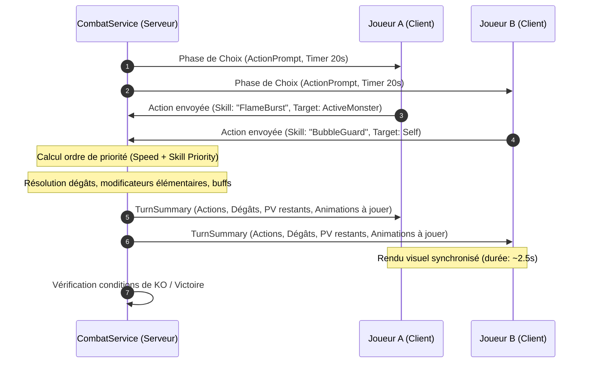

# Monster Islands — Système de Combat Tour par Tour

## 1. Vue d'Ensemble

Le système de combat de la Phase 1 (Vertical Slice) est **au tour par tour** et **intégralement résolu côté serveur**.
L'architecture découple rigoureusement le calcul des règles du moteur de rendu/animation client afin de permettre une migration ultérieure vers du combat en temps réel sans devoir réécrire la logique mathématique et élémentaire.

---

## 2. Déroulement d'un Tour de Combat

---

## 3. Formules Mathématiques de Combat

### Calcul des Dégâts
$$\text{Damage} = \left(\frac{2 \times \text{AttackerLevel}}{5} + 2\right) \times \text{SkillPower} \times \left(\frac{\text{AttackerAttack}}{\text{DefenderDefense}}\right) \times \frac{1}{50} + 2$$
$$\text{FinalDamage} = \text{Damage} \times \text{ElementMultiplier} \times \text{CritMultiplier} \times \text{Variance}$$

- **ElementMultiplier** : Tiré de `ElementDefinitions.luau` (ex: Feu contre Plante = 1.5, Feu contre Eau = 0.75).
- **CritMultiplier** : Chance de base 10% $\to$ dégâts multipliés par 1.5.
- **Variance** : Fluctuation aléatoire équilibrée entre 0.92 et 1.08.

### Ordre d'Action
1. Les actions de priorité haute (ex: `Shield`, `Switch`) s'exécutent en premier.
2. Pour les compétences d'attaque régulières, la vitesse effective (`EffectiveSpeed`) détermine l'attaquant prioritaire.
3. En cas d'égalité stricte, un tirage à 50/50 est effectué côté serveur.

---

## 4. Statuts et Effets

- **Burn (Brûlure)** : Inflige 6% des PV max au début de chaque tour pendant 3 tours. Réduit l'attaque physique de 15%.
- **Poison (Poison)** : Inflige des dégâts croissants chaque tour (5%, 10%, 15%).
- **Shield (Bouclier)** : Réduit les dégâts subis de 40% pour le tour courant.
- **Stun (Étourdissement)** : Annule l'action du tour si le monstre ciblé n'a pas encore agi.
- **SpeedBoost (Vitesse accrue)** : Augmente la vitesse de 30% pendant 2 tours.

---

## 5. Transition vers le PvP Temps Réel (Phase 3)

La séparation entre la logique d'état et l'interface permet d'adapter le système plus tard :
- Les mêmes formules de calcul de dégâts et d'éléments sont réutilisées.
- Le cycle de tour discret (tick de 20s) sera simplement remplacé par un système de temps de recharge (Cooldowns) et d'attaques orientées dans l'espace 3D.
