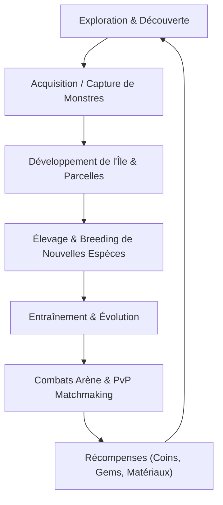

# Monster Islands — Game Design Document (GDD)

## 1. Vision et Piliers du Jeu

**Monster Islands** est un jeu Roblox original qui combine la collection de créatures fantastiques, le développement d'un territoire personnel (île et parcelles), l'expérimentation génétique avancée (breeding) et des combats multijoueurs stratégiques.

### Piliers de gameplay
1. **Territoire Vivant & Personnalisation** : Le joueur ne se contente pas d'accumuler des monstres dans un inventaire statique ; il possède et étend son île, y place ses monstres dans des habitats thématiques, et récolte des ressources générées par ses créatures.
2. **Système Génétique Profond (Breeding)** : La reproduction combine éléments, affinités, statistiques héréditaires et mutations rares. Les joueurs apprennent les arbres généalogiques pour débloquer des créatures légendaires.
3. **Exploration & Liberté** : Un monde 3D dynamique avec une île centrale, des zones sauvages et des îles flottantes où trouver des créatures rares, des matériaux et des défis.
4. **Combats Stratégiques Tour par Tour (évolutif vers PvP temps réel)** : Combats basés sur une matrice élémentaire riche, des synergies d'équipe (3 à 5 monstres), des compétences dynamiques et du statut tactique.
5. **Économie Juste & Non Pay-To-Win** : Une progression fluide et valorisante, où les compétences et la gestion priment sur l'achat immédiat.

---

## 2. Boucle Principale de Gameplay (Core Loop)

---

## 3. Territoire & Parcelles

Chaque joueur dispose d'une île personnelle divisée en parcelles carrées (ex: 32x32 studs) déblocables progressivement :
- **Parcelle 1 (Starter)** : Offerte gratuitement au premier spawn. Contient le nid initial et un espace d'accueil pour 2 monstres.
- **Parcelles 2 à 5** : Achetables avec des pièces (`Coins`) gagnées en jeu ou débloquées selon le niveau du joueur.
- **Parcelles Spéciales** : Dédiées à des bâtiments fonctionnels :
  - *Couvoir / Hatchery* : Incubation des œufs issus du breeding.
  - *Centre de Reproduction* : Placement de deux parents compatibles.
  - *Arène d'Entraînement* : Gain passif d'XP pour les créatures assignées.

---

## 4. Éléments et Affinités

Le monde de Monster Islands s'articule autour de 8 éléments principaux :
1. **Fire (Feu)** : Agressif, dégâts élevés sur la durée (Brûlure).
2. **Nature (Végétal)** : Résilience, régénération et absorption de PV.
3. **Water (Eau)** : Vitesse, affaiblissement et nettoyage des altérations.
4. **Earth (Terre)** : Haute défense physique, contrôle et étourdissements.
5. **Wind (Vent)** : Vitesse prioritaire, esquive et attaques critiques.
6. **Shadow (Ombre)** : Dégâts perçants, peur et effets d'affaiblissement d'énergie.
7. **Light (Lumière)** : Soutien, boucliers et dissipation d'obscurité.
8. **Arcane (Mystique)** : Dégâts magiques purs et manipulation des temps de recharge.

---

## 5. Mode Combat (Vertical Slice Tour par Tour)

- **Format** : 1v1 avec équipes de 1 à 3 monstres actifs (remplaçables).
- **Phases de tour** :
  1. *Sélection d'action* : Le joueur choisit entre Attaque, Compétence spéciale, Changement de monstre ou Passer. Un chronomètre de 20 secondes évite l'anti-jeu.
  2. *Résolution serveur* : Le serveur classe les actions selon la statistique de `Speed` de chaque monstre actif, calcule la précision, les dégâts élémentaires, les coups critiques et les effets de statut.
  3. *Diffusion & Rendu client* : Le serveur envoie le rapport du tour aux deux clients, qui jouent les animations synchronisées.
  4. *Condition de fin* : Lorsqu'une équipe n'a plus de monstres avec PV > 0, le combat prend fin et les récompenses (XP, Coins) sont distribuées.

---

## 6. Accessibilité et Rétention

- Sauvegarde automatique toutes les 3 minutes et lors de la déconnexion.
- Pas de perte de monstres lors des combats (permadeath absent).
- Tutoriel naturel et guidé par des quêtes d'initiation.
