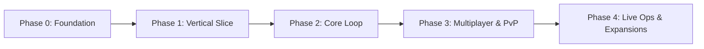

# Monster Islands — Feuille de Route de Développement

---

## Phase 0 — Foundation & Infrastructure *(En cours)*
- [x] Initialisation du dépôt GitHub et architecture Rojo
- [x] Documentation complète (GDD, Architecture, Monstres, Combat, Breeding, Économie, Art Direction)
- [x] Configuration Luau stricte avec types partagés (`Types.luau`)
- [x] Moteur de logging structuré (`Logger.luau`)
- [x] Abstraction DataStore avec support hors-ligne/Studio (`PlayerDataService.luau`)
- [x] Tests unitaires pour l'économie, les parcelles, le breeding et le combat

---

## Phase 1 — Vertical Slice Jouable *(Milestone Actuel)*
- [x] Génération de la carte starter (Île principale, Hub, Zone de parcelles, Arène)
- [x] Spawning du joueur et initialisation sécurisée du profil
- [x] Attribution de la première parcelle gratuite
- [x] Déblocage et achat de la seconde parcelle via l'économie
- [x] Registre des 5 monstres prototypes (`Emberfox`, `Mossaur`, `Aquaphin`, `Zephlyn`, `Noctyra`)
- [x] Affichage 3D d'un monstre placé sur sa parcelle
- [x] Interface de Collection (Affichage des statistiques, éléments, niveau)
- [x] Système de Reproduction (Breeding) avec hérédité de stats et découverte
- [x] Moteur de combat tour par tour serveur avec calcul élémentaire
- [x] Matchmaking 1v1 simplifié et boucle de victoire/défaite avec récompenses

---

## Phase 2 — Core Expansion & Bâtiments
- [ ] Bâtiments interactifs (Couvoir physique, Nids élémentaires, Arbres à baies)
- [ ] Système d'alimentation et d'entraînement pour faire monter les monstres en niveau
- [ ] Évolution visuelle des monstres aux paliers de niveau (ex: Niveau 15 et 30)
- [ ] Système de quêtes quotidiennes et hauts-faits avec récompenses
- [ ] Inventaire complet avec consommables (potions de soin, stimulants)
- [ ] Nouvelles zones explorables (Volcan, Forêt Mystique, Toundra Givrée)

---

## Phase 3 — Multijoueur Avancé & Compétition
- [ ] File de Matchmaking avec classement Elo/MMR
- [ ] Équipes complètes de 3 contre 3 avec remplacements tactiques en cours de combat
- [ ] Mode combat temps réel optionnel en arène dédiée
- [ ] Saisons compétitives et récompenses de classement exclusives
- [ ] Système de spectateur d'arène

---

## Phase 4 — Live-Ops & Événements Mondiaux
- [ ] Boss mondiaux coopératifs sur l'île centrale
- [ ] Événements saisonniers (Tempête de Feu, Fête de la Moisson) avec monstres exclusifs
- [ ] Guildes et territoires de guilde
- [ ] Personnalisation cosmétique d'îles et d'auras
